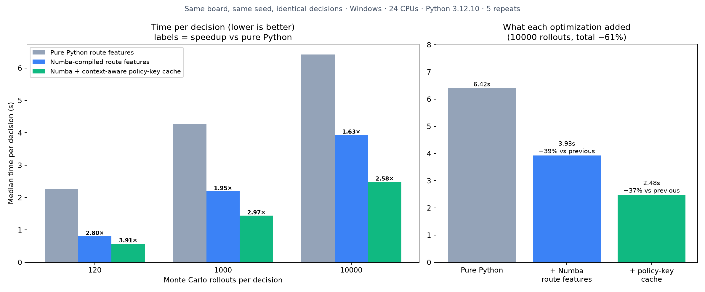
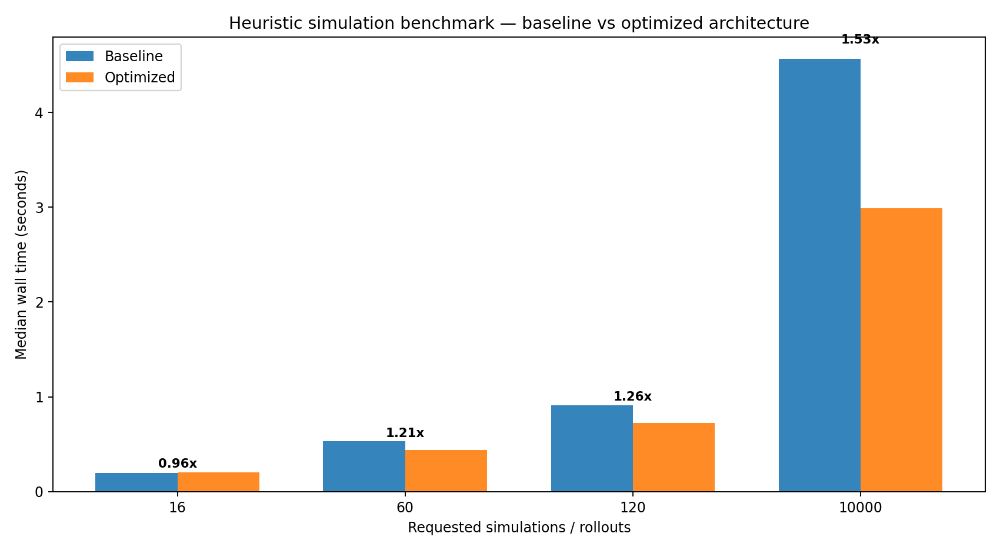
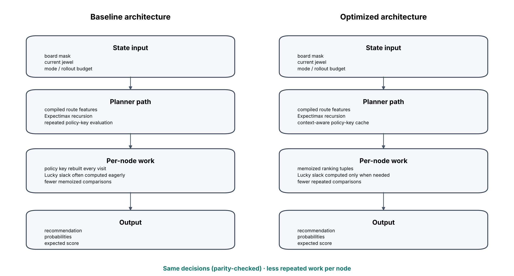

# Vision Expectimax Decision Engine

[](https://github.com/flemuh/vision-expectimax-decision-engine/actions/workflows/ci.yml)

Screen-vision board reader plus a probabilistic decision engine for a **stochastic 5×5 board puzzle** (14 random draws, 6 symbol types, line-completion scoring).

The engine reads the board from a screenshot, then ranks every legal move with:

- **bitmask state representation** for constant-time board operations;
- **exact endgame search** for the last moves;
- **Monte Carlo rollouts** for the rest of the game;
- **Expectimax-style refinement** over the stochastic draws;
- **Numba-compiled route features** (`vision_engine/solver/r39_plan_kernel.py`);
- a **context-aware policy-key cache** that removes repeated ranking work.

**Recommendation-only.** The assistant shows the suggested cell; it never moves the mouse or sends input to any window. A test (`tests/test_p5_cleanup.py::test_public_build_never_sends_input_to_the_game`) enforces this.

---

## Benchmark: what each optimization added

Same board, same seed, same rollout budget, three engine configurations. `tools/benchmark_evolution.py` **fails if any configuration recommends a different move or utility**, so every speedup below comes with identical decisions.

1. **Pure Python** route features (starting point)
2. **+ Numba**: route-feature kernel JIT-compiled (`vision_engine/solver/r39_plan_kernel.py`)
3. **+ policy-key cache**: Expectimax ranking tuples memoized per context, Lucky slack computed only when needed



| Rollouts | Pure Python (s) | + Numba (s) | + Numba + cache (s) | Total time reduction | Total speedup |
|---:|---:|---:|---:|---:|---:|
| 120 | 2.26 | 0.81 | 0.58 | 74.5% | 3.91× |
| 1 000 | 4.27 | 2.19 | 1.44 | 66.3% | 2.97× |
| 10 000 | 6.42 | 3.93 | 2.48 | 61.3% | 2.58× |

At 10 000 rollouts, Numba removes **39%** of the time and the cache removes another **37%** of what is left.

Measured on Windows 11, Intel (24 logical CPUs), Python 3.12.10, Numba 0.68.0, **5 repeats per budget**, medians reported (raw runs in `benchmark-results/evolution/benchmark_evolution.csv`). At 10 000 rollouts every repeat is within ±5% of the median; at 1 000 within ±7%, except one pure-Python run that was 22% slower. At 120 rollouts the first two repeats of every variant were about 2× slower (warm-up), so that row is the least stable. Numba is faster at every budget; its relative gain shrinks as the budget grows because more of the time is spent in the rollouts themselves rather than in route features.

Reproduce (about 5 minutes):

```bash
python -m pip install -r requirements-benchmark.txt
python tools/benchmark_evolution.py --rollouts 120 1000 10000 --repeats 5
```

On Windows: `benchmark_evolution_windows.bat`.

---

## Earlier benchmark: cache on vs off (both compiled)

First measurement of the cache alone, on a different machine. Both variants use the compiled route features. `tools/benchmark_compare.py` runs both on the same board and seed and **fails if the recommended moves or utilities differ**.

| Rollouts | Baseline median (s) | Optimized median (s) | Time reduction | Speedup |
|---:|---:|---:|---:|---:|
| 16 | 0.198 | 0.207 | −4.4% | 0.96× |
| 60 | 0.533 | 0.441 | 17.4% | 1.21× |
| 120 | 0.910 | 0.723 | 20.6% | 1.26× |
| 10 000 | 4.563 | 2.988 | 34.5% | 1.53× |





**How to read these numbers**

- Measured on Linux, Python 3.13, 5 CPUs, **only 2 repeats per budget**, one reference board (`benchmark-results/compare/benchmark_compare.json`, raw runs in the `.csv`). Treat them as indicative, not a general claim.
- At 16 rollouts the cache overhead is larger than the saving.
- The gain grows with the rollout budget because more states are revisited.
- Run it on your own machine (below); results depend on CPU and Numba version.

---

## Quick start

```bash
python -m pip install -r requirements.txt
python app.py            # desktop assistant (Windows, Tkinter)
```

On Windows you can also use `run_windows.bat`, which creates an isolated environment.

### Reproduce the benchmark

```bash
python -m pip install -r requirements-benchmark.txt
python tools/benchmark_compare.py --rollouts 16 60 120 10000 --repeats 3 --output benchmark-results/compare
```

Outputs: `benchmark_compare.csv` (every run), `benchmark_compare.json` (medians, machine info), `benchmark_compare.png`, `architecture_compare.png`. On Windows: `benchmark_windows.bat`.

### Run the tests

```bash
python -m pip install -r requirements-benchmark.txt
python -m pytest -q
```

GitHub Actions (`.github/workflows/ci.yml`) runs the full suite on Python 3.11 and 3.12 and a small benchmark with the decision-parity check, uploading its CSV/JSON/PNG as an artifact.

---

## Repository layout

```text
vision_engine/           vision, advisor, scoring, route math, solver
vision_engine/solver/    Numba kernels, Expectimax engine, solver service
tools/                   benchmark, backtest, offline analysis, reports
tests/                   regression, parity and contract tests
assets/benchmark/        images used in this README
benchmark-results/       reference benchmark CSV / JSON / PNG
examples/boards/         sample boards
app.py                   desktop entry point
```

## Limitations

- Benchmarks cover one reference board; results depend on CPU and Numba version.
- Screen reading is calibrated for a specific board layout and needs the one-time setup in the app.
- The desktop app targets Windows; the engine, tests and benchmark run on Linux.

## License

MIT
